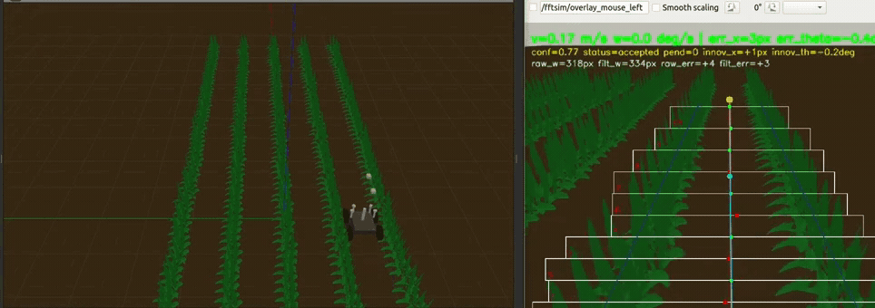

# Multi-ROI Crop Navigation

Adaptive crop row detection, corridor estimation, and visual
navigation for agricultural robotics. Process field images or video, inspect
segmentation and row geometry, and export navigation commands for analysis.
An optional ROS 2 and Gazebo Classic rig provides simulated camera input and
rover control.


[](https://github.com/A-C-Simon/multi-roi-crop-navigation/actions/workflows/checks.yml)


*Field photograph from the original project collection (`photo_7`). The panels
show segmentation, weed removal, strip regions, and the fitted corridor. The
[original image](examples/field/photo_7_2026-08-18_17-17-57.png) is included so
you can reproduce this output.*

## Navigation demonstration

[](https://github.com/A-C-Simon/multi-roi-crop-navigation/raw/refs/heads/main/docs/assets/navigation-demo.mp4)

Gazebo rover navigation with the live camera overlay beside the simulated
field. Click the animated preview to watch the full recording (63 seconds,
MP4, 7.4 MB).

## What is included

- Vegetation segmentation with excess green, Otsu thresholding, and morphology.
- Adaptive strip regions, flanking row selection, and corridor fitting.
- Optional temporal filtering, lookahead memory, and visual servo commands.
- Image and video outputs, diagnostic CSV files, and a Python interface.
- A separate simulator setup with straight, curved, circular, and zigzag fields.

## Install

Use Python 3.10, 3.11, or 3.12. The reference environment is Linux with Python
3.10. ROS 2 is optional and is not required for image or video processing.

```bash
git clone https://github.com/A-C-Simon/multi-roi-crop-navigation.git
cd multi-roi-crop-navigation
python3 -m venv .venv
source .venv/bin/activate
python -m pip install --upgrade pip
python -m pip install .
```

See [installation](docs/installation.md) for system packages, an editable
installation, and the tested dependency versions.

## Try it

Run detection on the included field photograph:

```bash
multiroi-detect --input examples/field --results_dir outputs/field-example
```

Open the composite PNG in `outputs/field-example` to inspect the same four
panels shown above. The input is copied from the original photo collection
without resizing or retouching. See [image details](docs/assets/README.md).

For a short generated video, first create the test inputs:

```bash
python examples/generate_sample.py
multiroi-nav --input examples/data/corridor.mp4 --video --output outputs/video
```

Process your own images:

```bash
multiroi-detect --input /path/to/images --results_dir outputs/field
multiroi-nav --input /path/to/images --output outputs/navigation
```

Always pass an input path. The original scripts retain their historical
`../../Photos` default, which is not bundled here. Output directories are
created as needed; use a different directory for each run you want to keep.

## Documentation

The [Technical Design and Integration Reference](docs/technical-documentation.md)
provides the complete system description, algorithm details, configuration
reference, and integration procedures. A [PDF edition](docs/technical-documentation.pdf)
is available for technical review and distribution.

| Guide | Contents |
| --- | --- |
| [Technical documentation](docs/technical-documentation.md) | Design, algorithms, interfaces, configuration, and verification |
| [Installation](docs/installation.md) | Python setup, dependency versions, verification |
| [Usage](docs/usage.md) | Image, video, camera, and reference detector commands |
| [Python interface](docs/python-api.md) | Detection results and frame processing |
| [Architecture](docs/architecture.md) | Pipeline stages and source file map |
| [Outputs](docs/outputs.md) | Panels, CSV fields, units, and interpretation |
| [Simulation](docs/simulation.md) | ROS 2 Humble and Gazebo Classic setup |
| [Troubleshooting](docs/troubleshooting.md) | Installation, input, codec, and simulation issues |
| [Validation](docs/validation.md) | Automated checks, output verification, and recorded demonstration |
| [Project origin](docs/provenance.md) | Original repository, source snapshot, and research reference |

## Development checks

```bash
python -m pip install -e '.[dev]'
python -m pytest
python scripts/verify_snapshot.py
```

The test suite contains eight synthetic checks covering corridor tracking,
filtering, and drawing coverage. The snapshot check verifies that the preserved
source files match the recorded import.

## Project origin

This repository is a standalone distribution of the MultiROI work in
[A-C-Simon/Crop_row_detection](https://github.com/A-C-Simon/Crop_row_detection/tree/main/LinReg/MultiROI).
It has a separate history and a documented source snapshot. It is based on
[Zhou et al. (2021)](https://doi.org/10.25165/j.ijabe.20211404.6315), with
subsequent detector and navigation extensions.
