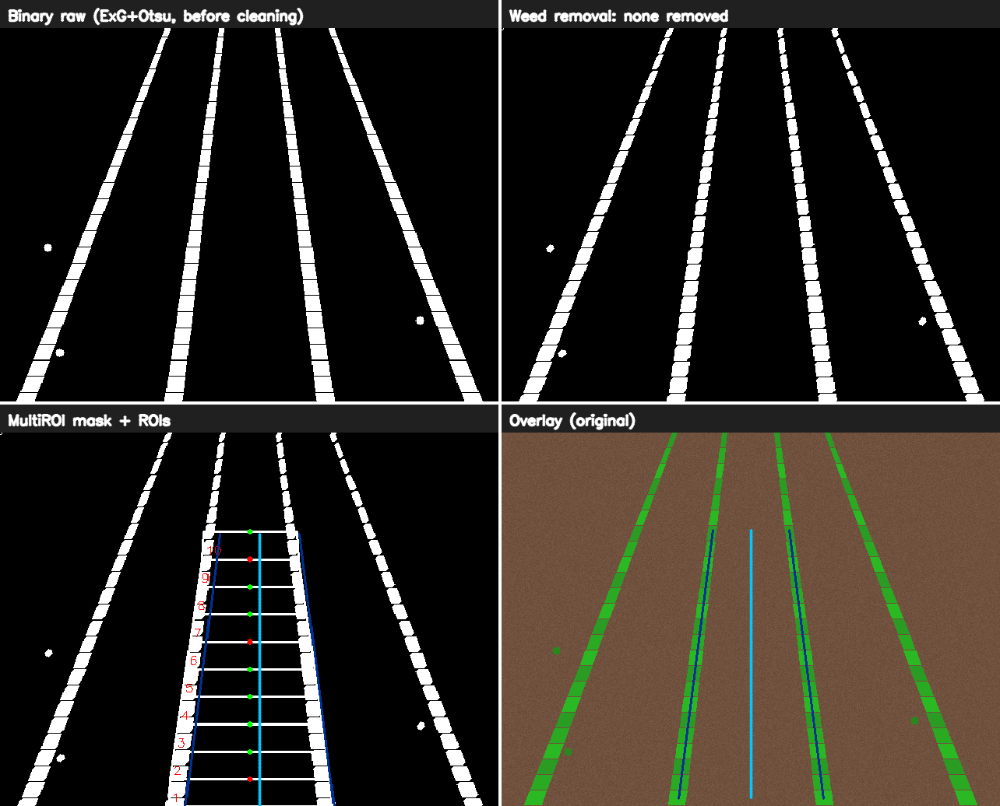

# Multi-ROI Crop Navigation

Adaptive crop row detection, corridor estimation, and experimental visual
navigation for agricultural robotics. Process field images or video, inspect
segmentation and row geometry, and export navigation commands for analysis.
An optional ROS 2 and Gazebo Classic rig provides simulated camera input and
rover control.


[](https://github.com/A-C-Simon/multi-roi-crop-navigation/actions/workflows/checks.yml)



*Generated example scene. The panels show segmentation, weed removal, strip
regions, and the fitted corridor. This image demonstrates the output format;
it is not a field accuracy benchmark.*

## What is included

- Vegetation segmentation with excess green, Otsu thresholding, and morphology.
- Adaptive strip regions, flanking row selection, and corridor fitting.
- Optional temporal filtering, lookahead memory, and visual servo commands.
- Image and video outputs, diagnostic CSV files, and a Python interface.
- A separate simulator setup with straight, curved, circular, and zigzag fields.

This is a research preview. Detection and control have known correctness limits.
Exported commands need independent validation before use on a physical robot.
This distribution preserves the source algorithms from the original project.

## Install

Use Python 3.10, 3.11, or 3.12. The reference environment is Linux with Python
3.10. ROS 2 is optional and is not required for image or video processing.

```bash
git clone https://github.com/A-C-Simon/multi-roi-crop-navigation.git
cd multi-roi-crop-navigation
python3 -m venv .venv
source .venv/bin/activate
python -m pip install --upgrade pip
python -m pip install .
```

See [installation](docs/installation.md) for system packages, an editable
installation, and the tested dependency versions.

## Try it

Generate a small example dataset and run detection:

```bash
python examples/generate_sample.py
multiroi-detect --input examples/data --results_dir outputs/detection
```

The example generator writes two PNG images and a short MP4. It needs no field
dataset or download. Open the PNG files in `outputs/detection` to inspect the
results.

Process the example video:

```bash
multiroi-nav --input examples/data/corridor.mp4 --video --output outputs/video
```

Process your own images:

```bash
multiroi-detect --input /path/to/images --results_dir outputs/field
multiroi-nav --input /path/to/images --output outputs/navigation
```

Always pass an input path. The original scripts retain their historical
`../../Photos` default, which is not bundled here. Output directories are
created as needed; use a different directory for each run you want to keep.

## Documentation

| Guide | Contents |
| --- | --- |
| [Installation](docs/installation.md) | Python setup, dependency versions, verification |
| [Usage](docs/usage.md) | Image, video, camera, and reference detector commands |
| [Python interface](docs/python-api.md) | Detection results and frame processing |
| [Architecture](docs/architecture.md) | Pipeline stages and source file map |
| [Outputs](docs/outputs.md) | Panels, CSV fields, units, and interpretation |
| [Simulation](docs/simulation.md) | ROS 2 Humble and Gazebo Classic setup |
| [Troubleshooting](docs/troubleshooting.md) | Installation, input, codec, and simulation issues |
| [Validation and limits](docs/validation.md) | What is checked and what remains unverified |
| [Project origin](docs/provenance.md) | Original repository, source snapshot, and research reference |

## Development checks

```bash
python -m pip install -e '.[dev]'
python -m pytest
python scripts/verify_snapshot.py
```

The test suite contains eight synthetic checks. These checks do not establish
field accuracy or validate unattended driving. The snapshot check verifies
that the preserved source files match the recorded import.

## Origin and licensing

This repository is a standalone distribution of the MultiROI work in
[A-C-Simon/Crop_row_detection](https://github.com/A-C-Simon/Crop_row_detection/tree/main/LinReg/MultiROI).
It has a separate history and a documented source snapshot. It is based on
[Zhou et al. (2021)](https://doi.org/10.25165/j.ijabe.20211404.6315), with
subsequent detector and navigation extensions.

The original project did not specify a root software license. This distribution
preserves that status. See [LICENSE](LICENSE) and
[third-party notices](THIRD_PARTY_NOTICES.md) for the separate simulation and
plant-model terms.
