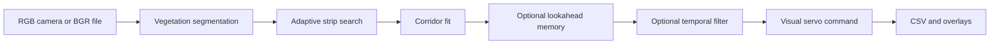

# Architecture

## Processing flow

OpenCV inputs use BGR channel order. Vegetation is segmented using an excess
green index, Otsu thresholding, and morphological opening. In the extended
CLI, `struct` morphology adds a component filter based on strip projection
bands. The search then climbs from the bottom strip toward the top, selecting
flanking crop bands and renewing the corridor window.

The extended detector fits a total least squares navigation line. A smoothed
spline can represent moderate corridor curvature. The navigation layer converts
image geometry to lateral and heading features, optionally applies memory and
filtering, and calculates linear and angular commands.

## File map

| File | Responsibility |
| --- | --- |
| `multi_roi.py` | Preserved reference implementation and image CLI |
| `test_multi_roi.py` | Extended detector, visualization, and image CLI |
| `lookahead_corridor_map.py` | Strip corridor memory and prediction |
| `temporal_filter.py` | Scalar state filtering and command smoother |
| `mr_vs.py` | Feature extraction and visual servo controller |
| `run_mr_navigation.py` | Shared frame processing and offline navigation CLI |
| `mr_navigation_stack.py` | Stateful stack and differential-drive kinematics helper |
| `test_temporal_filter.py` | Eight existing synthetic regression checks |
| `tests/sim_ros2` | Optional ROS 2 and Gazebo Classic workspace |

Despite its name, `test_multi_roi.py` is a runtime detector module. Its name is
retained because the navigation and simulator modules import it directly.

## Offline processing and simulation

Offline files do not change in response to generated commands. The kinematics
helper integrates commands into a pose estimate; it does not render a new
camera view. Gazebo supplies that feedback through the simulated camera and
rover dynamics.

The existing simulator adapter uses paper morphology, temporal filtering, and
no lookahead map. The offline video CLI uses struct morphology and enables
both temporal filtering and lookahead by default. They share source modules
but do not run the same configuration.

## Configuration

Configuration remains in Python dataclasses and the existing command-line
arguments. This distribution adds packaging around those interfaces. It does
not change detector thresholds, control gains, filtering rules, or fallback
behavior.
